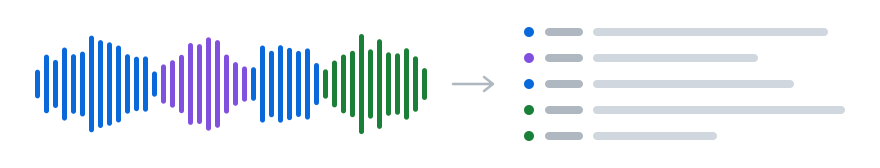

<p align="center">
  <picture>
    <source media="(prefers-color-scheme: dark)" srcset="assets/header-dark.svg">
    
  </picture>
</p>

<h1 align="center">meeting-scribe</h1>

<p align="center">
  Запись встречи → транскрипт со спикерами → фоллоу-ап для участников.<br>
  Интерфейса нет: вы даёте <a href="https://developers.openai.com/codex/">Codex</a> или <a href="https://claude.com/product/claude-code">Claude Code</a> путь к файлу, остальное агент делает сам.
</p>

<br>

```
> вот запись: ~/Downloads/sync.m4a

  meetings/2026-10-08-sync/transcript.md
  meetings/2026-10-08-sync/followup.md
```

## Что получается

**transcript.md** — дословно, с таймкодами. Агент узнаёт имена по обращениям, неопознанные остаются «Спикер N»:

> **[00:00:00] Спикер 1:** Коллеги, добрый день. Начнём синк по релизу. Андрей, что с бэкендом?
>
> **[00:00:05] Андрей:** Миграцию базы закончили вчера, осталось починить два бага в API авторизации. Думаю, к пятнице успеем.
>
> **[00:00:14] Спикер 1:** Мария, а по фронтенду?
>
> **[00:00:17] Мария:** Есть блокер: макеты онбординга ещё не согласованы. До среды согласую с дизайнером.

**followup.md** — итоги для рассылки: суть, решения, задачи, открытые вопросы, ход обсуждения со ссылками на таймкоды.

| Что | Кто | Срок |
|---|---|---|
| Согласовать макеты онбординга с дизайнером | Мария | среда |
| Починить два бага в API авторизации | Андрей | пятница |

Задачей становится только то, что человек взял на себя. Готовый фоллоу-ап сверяет с транскриптом независимый агент: пытается опровергнуть каждое утверждение и ищет пропущенные договорённости. Для чата участников делается копия без ссылок на транскрипт: `Итоги встречи 08.10 — Релиз.md`.

## Установка

Нужны macOS или Linux, [uv](https://docs.astral.sh/uv/), ffmpeg (включая ffprobe), Codex или Claude Code и ключ [OpenRouter](https://openrouter.ai/keys) с пополненным балансом. Python 3.12+ и зависимости скриптов подберёт `uv`.

```bash
git clone https://github.com/smalyu/meeting-scribe && cd meeting-scribe
cp .env.example .env    # вписать OPENROUTER_API_KEY
```

Откройте папку проекта в приложении Codex и дайте путь к аудио в локальном чате. Для Codex CLI запустите `codex` из этой папки; для Claude Code — `claude`. Codex читает [AGENTS.md](AGENTS.md), а `CLAUDE.md` подключает тот же файл для Claude Code. Отдельный перенос инструкций не нужен.

**Встречи обрабатывайте в основной папке проекта.** `meetings/`, `.env` и `glossary.txt` не хранятся в Git и автоматически не попадают в worktree. Без прежнего `meetings/` недоступен кэш и возможна повторная оплата распознавания. Worktrees подходят для изменений кода и синтетических тестов.

Без агента скрипт тоже работает, но имена спикеров вписываются вручную, а фоллоу-ап составляется отдельно:

```bash
uv run scribe.py ~/Downloads/sync.m4a --terms "Kubernetes,Иван Петров"
uv run scribe.py names meetings/2026-10-08-sync 2=Андрей 3=Мария
uv run scribe.py join meetings/2026-10-08-sync meetings/2026-10-08-sync-2   # две записи одной встречи → один транскрипт
uv run scribe.py share meetings/2026-10-08-sync    # followup.md → копия для чата участников
```

## Под капотом

```
запись
  │  ffmpeg: моно 16 кГц, куски по ~30 мин, разрез в самой тихой точке
  ├─→ MAI-Transcribe-2 ──→ слова и таймкоды
  └─→ Scribe v2 ─────────→ спикеры: куски внахлёст на 5 мин,
                           метки сшиваются по общим словам
  ↓
  каждому слову — спикер по пересечению во времени ──→ transcript.md
  ↓
  агент: имена спикеров ──→ followup.md ──→ проверка одним субагентом
```

В записях [Zoom Audio Recorder](https://github.com/smalyu/zoom-audio-recorder) спикеров называет сам Zoom: в файле сохранено, кого он подсвечивал как говорящего и когда звучал микрофон того, кто записывал. Scribe тогда уточняет границы реплик и подменяет Zoom там, где окна встречи не было видно. Если подсветка весь звонок простояла на одном имени, она не учитывается: говорящих делят микрофон и Scribe.

Оба движка вызываются через OpenRouter, ответы кэшируются в `meetings/*/raw/`. При полном кэше и прежней нарезке повторный запуск бесплатный: папка находится по самой записи, даже если её переименовали. Куски распознаются параллельно. В замерах проекта час записи стоил около $0,25; скрипт печатает фактическую стоимость каждого прогона. Работа агента оплачивается отдельно по условиям выбранного сервиса. Дата и время записи берутся из тега `creation_time` файла и попадают в начало транскрипта; метаданные не всегда совпадают с фактическим временем встречи.

## Проверки без платных запросов

После изменения кода:

```bash
uv run test_scribe.py
```

Тесты генерируют короткий звук через ffmpeg и подменяют HTTP-запросы. Неожиданный HTTP-запрос завершает тест с ошибкой.

Для проверки существующей встречи:

```bash
uv run scribe.py check meetings/2026-10-08-sync
```

`check` копирует транскрипт, заметки и кэш во временную папку и пересобирает все записи встречи. Ключ API не нужен, сетевых запросов нет, оригиналы сохраняются. Исходное аудио должно быть доступно по пути из `transcript.json`. Код выхода 0 означает совпадение; 1 — различия или ошибку. При различиях команда называет файлы и изменившиеся поля JSON. Ручные правки реплик тоже дают различия: это повод изучить результат, а не автоматически заменить оригинал.

Если нужно именно пересобрать транскрипт на месте, используя только готовые ответы:

```bash
uv run scribe.py ~/Downloads/sync.m4a --cache-only
```

`--cache-only` проверяет наличие всех кусков до изменений файлов и отказывается работать, если хотя бы одного нет, в том числе после изменения нарезки. Ключ API не нужен. **Пересборка на месте стирает ручные правки реплик**, как и обычный повторный запуск; для проверки используйте `check`.

## Почему MAI-Transcribe-2

Сравнение вслепую на реальной очной встрече (2 ч 41 мин, октябрь 2026):

| | Пропущено слов¹ | Выбран лучшим² | Ошибок на фрагмент² |
|---|--:|--:|--:|
| **MAI-Transcribe-2** | **3,5%** | **52%** | **2,0** |
| ElevenLabs Scribe v2 | 6,8% | 38% | 2,3 |
| Gemini 3.5 Transcribe | 20,3% | 10% | 4,8 |

<sub>¹ Слова, которые распознали оба других движка, а этот — нет.<br>
² 60 спорных фрагментов, 175 голосов. Три аудиомодели (GPT Audio, Qwen Omni, MiMo) слушали фрагмент, не зная, какой движок какой, считали ошибки в каждом из трёх вариантов текста и выбирали самый точный.<br>
Gemini 3.1 Pro по словам почти не уступает MAI, но даёт таймкод только на реплику, а не на каждое слово, и работает в 5–10 раз медленнее.</sub>

Спикеров MAI через OpenRouter не размечает, поэтому их даёт Scribe.

## Ограничения

- **Очные встречи на один телефон.** Диаризация дробит людей на десятки меток, агент сводит их к участникам по смыслу реплик, ошибки возможны. Записи из Zoom или Телемоста размечаются заметно лучше, а записи Zoom Audio Recorder — точнее всего.
- **Только русский язык.** Он задан в `scribe.py`.
- **Данные уходят в облако.** Звук — через OpenRouter в Microsoft и ElevenLabs, текст транскрипта — в выбранный сервис агента (OpenAI для Codex, Anthropic для Claude Code).

## Файлы

```
scribe.py       аудио → transcript.md; один файл, зависимости ставит uv
test_scribe.py  тесты без сети и без затрат: uv run test_scribe.py
AGENTS.md       порядок работы для Codex и Claude Code
CLAUDE.md       подключает AGENTS.md для Claude Code
docs/followup-template.md  шаблон фоллоу-апа
docs/recognition-notes.md  устройство движков и наблюдения по встречам
glossary.txt    постоянные имена и термины, по строке; не попадает в git
meetings/       результаты, не попадают в git
```

<sub>MIT</sub>
